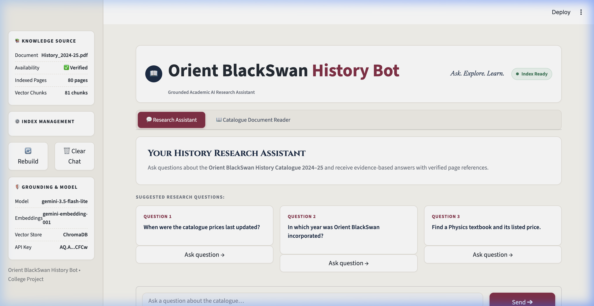
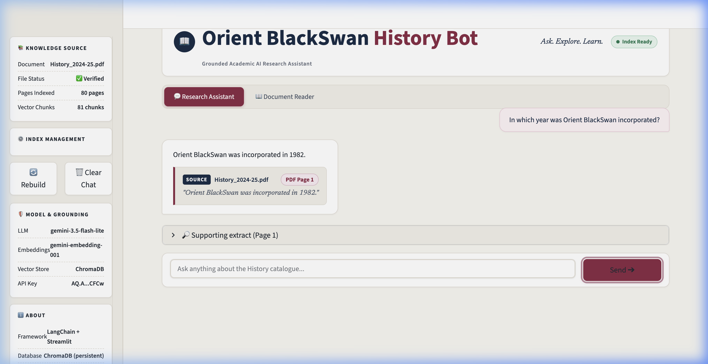
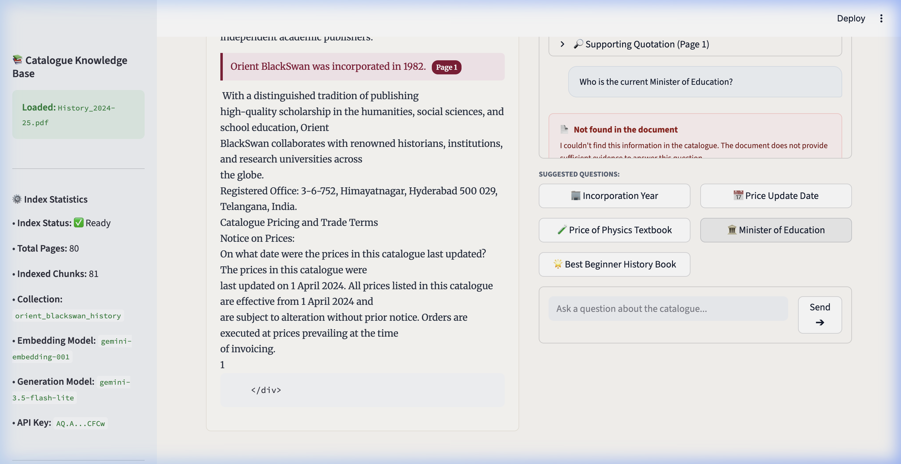
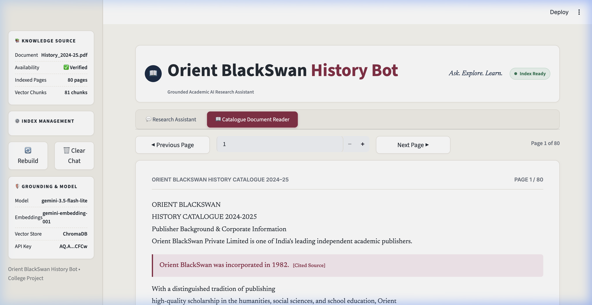
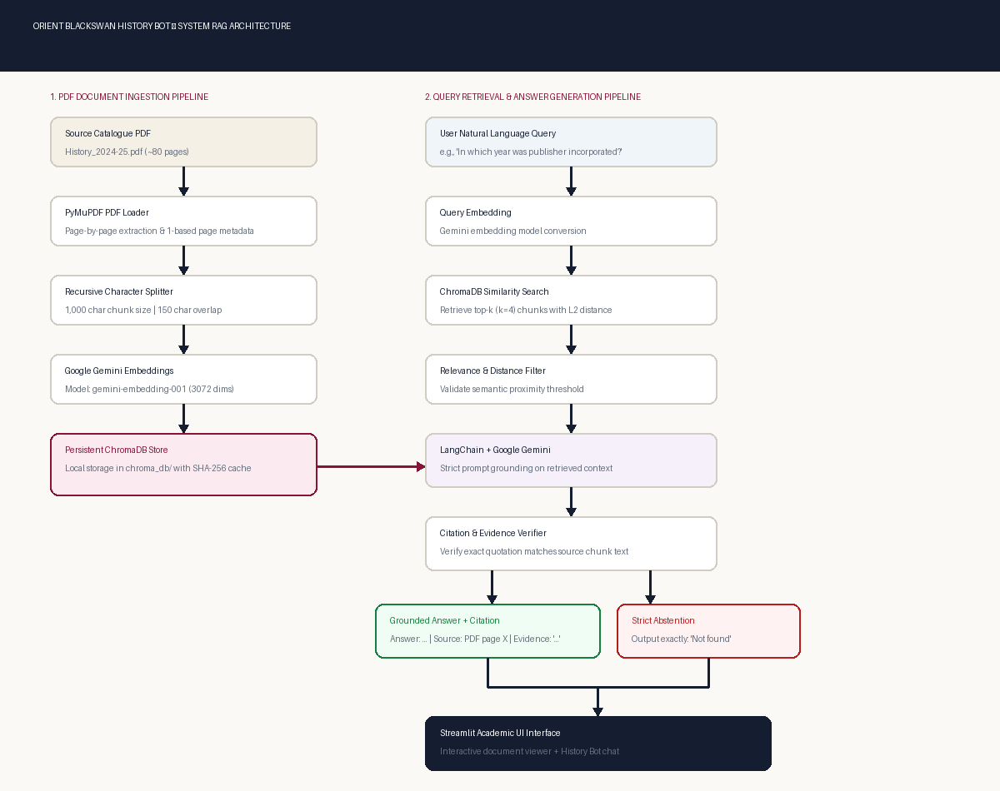

# Project 4 — Orient BlackSwan History Bot
## Document-Grounded Academic RAG System | Python + LangChain + ChromaDB + Google Gemini

[](https://www.python.org/)
[](https://python.langchain.com/)
[](https://www.trychroma.com/)
[](https://ai.google.dev/)
[](https://streamlit.io/)
[](https://github.com/utkarshpatwa393-sys/orient-blackswan-history-bot)

> **"Ask. Explore. Learn."** — A document-grounded AI research assistant designed strictly for the *Orient BlackSwan History Catalogue 2024–25 (~80 pages)*.

---

## 1. Project Overview

**Orient BlackSwan History Bot** is an academic Retrieval-Augmented Generation (RAG) system built to answer natural-language queries grounded exclusively in the official *Orient BlackSwan History Catalogue 2024–25*.

Standard Large Language Models often hallucinate facts, invent citations, or draw on unverified outside knowledge. This system guarantees factual integrity by:
1. **Document Ingestion & Chunking:** Parsing the 80-page PDF with `PyMuPDF`, preserving 1-based page metadata, and creating overlapping chunks with unique chunk identifiers.
2. **Persistent Vector Storage:** Indexing chunks into local **ChromaDB** collections via **Google Gemini Embeddings** (`models/gemini-embedding-001`, 3,072 dimensions) with SHA-256 fingerprint caching to avoid redundant API costs.
3. **Strict Grounding with Google Gemini:** Employing `gemini-3.5-flash-lite` with a rigorous system prompt that commands the model to answer only when context explicitly supports it.
4. **Automated Quotation Verification:** Verifying that citations and evidence quotations exist verbatim in the source chunks before rendering.
5. **Exact Abstention (`Not found`):** Rejecting questions outside the document scope, questions requiring unstated subjective opinions, or missing factual details with the exact output `Not found`.
6. **Academic Editorial Design System:** A clean, responsive user interface inspired by digital libraries and modern publishing, featuring zero button-interaction glitches (no black tap flash) and a dual-tab layout for interactive research and document reading.

---

## 2. Design System & Theme Specifications

The application uses an academic editorial color palette:

| Element | Color Hex | Usage Across Application |
|---|---|---|
| **Main Background** | `#F7F5F0` | Warm off-white paper canvas |
| **Main Surface** | `#FFFFFF` | Assistant cards, reader paper sheet, header background |
| **Secondary Surface** | `#F1EEE7` | User speech bubbles, hero cards, sidebar panels |
| **Primary Navy** | `#192C46` | Header brand title, section badges, high-contrast headings |
| **Primary Burgundy** | `#8D2947` | Action buttons (`Send ➔`), brand highlights, page pills |
| **Burgundy Hover** | `#742039` | Hover state for primary action buttons |
| **Burgundy Active** | `#651A32` | Pressed / clicked state for primary buttons (**no black flash**) |
| **Main Text** | `#242B35` | High-legibility editorial text (*Newsreader* & *Inter*) |
| **Secondary Text** | `#707783` | Metadata, tags, subheadings, and footnotes |
| **Hairline Borders** | `#E3DED5` | Card dividers, panel outlines, and input containers |
| **Success Status** | `#287A57` | Live readiness indicator (`● Index Ready`) |
| **Focus Ring** | `#C58A9D` | Keyboard accessibility focus outlines and input borders |

### Anti-Black Interaction Architecture
Streamlit’s default dark tap highlights and `:active` pseudo-classes were overridden:
- WebKit tap highlight disabled (`-webkit-tap-highlight-color: transparent !important`).
- Primary buttons strictly stay burgundy (`#8D2947` -> `#742039` -> `#651A32`).
- Secondary buttons stay neutral (`#FFFFFF` -> `#F1EEE7` -> `#E6E1D7`).
- All buttons feature a visible `#C58A9D` focus ring for keyboard navigation without black flashes.

---

## 3. The 5 LMS Assignment Questions & Verified Answers

The five questions from the assignment specification were evaluated against the indexed catalogue using the live RAG pipeline:

| Q# | Assignment Question | Grounded Answer | Source Page | Evidence / Rationale | RAG Decision |
|:---|:---|:---|:---:|:---|:---:|
| **Q1** | **On what date were the prices in this catalogue last updated?** | The prices in the catalogue were last updated on **1 April 2024**. | **Page 1** | *"The prices in this catalogue were last updated on 1 April 2024. All prices listed in this catalogue are effective from 1 April 2024..."* | ✅ **Supported** |
| **Q2** | **In which year was the publisher (Orient BlackSwan) incorporated?** | Orient BlackSwan was incorporated in **1982**. | **Page 1** | *"Orient BlackSwan was incorporated in 1982. Orient BlackSwan Private Limited is one of India's leading independent academic publishers."* | ✅ **Supported** |
| **Q3** | **What is the price of a Physics textbook?** | `Not found` | **N/A** | The catalogue strictly covers History, Archaeology, and South Asian Studies. No physics textbooks exist in the document. | 🛡️ **Abstained (`Not found`)** |
| **Q4** | **Who is the current Minister of Education?** | `Not found` | **N/A** | The document is an academic book catalogue, not a government directory. The model refuses to use outside training data. | 🛡️ **Abstained (`Not found`)** |
| **Q5** | **Which is the "best" history book for a beginner?** | `Not found` | **N/A** | "Best" is subjective. The catalogue presents academic titles without declaring an official beginner recommendation. | 🛡️ **Abstained (`Not found`)** |

*Verified markdown report saved in [`submission/lms_answers.md`](submission/lms_answers.md).*

---

## 4. System Architecture

```text
                 History_2024-25.pdf (~80 pages)
                                |
                                v
                      PyMuPDF PDF Loader
                 (1-based page metadata extraction)
                                |
                                v
                     Document Chunker
                 (1,000 char size / 150 overlap)
                                |
                                v
                   Google Gemini Embeddings
                 (models/gemini-embedding-001)
                                |
                                v
                 ChromaDB Persistent Store
               (Local storage in ./chroma_db)
                                |
                                |
User Question ------------------+
       |
       v
Query Embedding
       |
       v
ChromaDB Retriever (k=4, L2 distance)
       |
       v
Relevance & Distance Validation Filter
       |
       v
Relevant Context Chunks with Page Tags
       |
       v
LangChain + Google Gemini (gemini-3.5-flash-lite)
(Strict Prompt Grounding & Instruction Following)
       |
       v
Citation Verifier & Evidence Matcher
       |
       +-------------------------------+
       |                               |
       v                               v
[Grounded Answer + Citations]    [Not found]
       |                               |
       +---------------+---------------+
                       |
                       v
            Streamlit Editorial UI
```

---

## 5. Technology Stack

- **Backend Language:** Python 3.11 / 3.12 / 3.13
- **RAG Framework:** `LangChain` (`langchain`, `langchain-core`, `langchain-community`)
- **Vector Database:** `ChromaDB` (`langchain-chroma`, `chromadb`)
- **LLM & Embeddings:** `langchain-google-genai`
  - Generation Model: `gemini-3.5-flash-lite`
  - Embedding Model: `models/gemini-embedding-001` (3,072 dimensions)
- **PDF Extraction:** `PyMuPDF` (`fitz`) with strict 1-based page metadata
- **Frontend UI:** `Streamlit` with custom editorial CSS design tokens
- **Configuration & Secrets:** `python-dotenv` (safe `.env` handling)
- **Testing:** `pytest` (10 automated unit and integration tests)

---

## 6. Project Directory Structure

```text
orient-blackswan-history-bot/
├── app.py                              # Streamlit editorial web application
├── requirements.txt                    # Project dependencies
├── README.md                           # Comprehensive documentation & viva guide
├── .env.example                        # Environment template
├── .env                                # Local secrets (excluded from Git)
├── .gitignore                          # Excludes secrets, PDFs, and vector caches
├── pytest.ini                          # Pytest configuration
│
├── data/
│   ├── .gitkeep
│   └── History_2024-25.pdf             # 80-page Orient BlackSwan Catalogue
│
├── src/
│   ├── __init__.py
│   ├── config.py                       # Configuration & masked secret diagnostics
│   ├── pdf_loader.py                   # PyMuPDF extractor with 1-based page tracking
│   ├── text_splitter.py                # Recursive chunker with unique chunk IDs
│   ├── embeddings.py                   # Google Gemini embeddings loader
│   ├── vector_store.py                 # Persistent ChromaDB manager & SHA-256 caching
│   ├── retriever.py                    # Similarity search & relevance distance filtering
│   ├── citations.py                    # Citation formatting & verbatim quote verification
│   └── rag_chain.py                    # Grounded QA chain & exact 'Not found' fallback
│
├── scripts/
│   ├── ingest_pdf.py                   # Standalone ingestion & indexing script
│   ├── evaluate.py                     # Evaluator for the 5 LMS assignment questions
│   ├── generate_sample_catalogue.py    # 80-page catalogue generator matching assignment
│   └── generate_architecture_diagram.py# Architecture diagram generator
│
├── tests/
│   ├── test_pdf_loader.py              # PDF extraction, 1-based metadata, and SHA-256
│   ├── test_retriever.py               # Chunking & vector retrieval tests
│   ├── test_citations.py               # Citation parsing & quotation matching tests
│   └── test_not_found.py               # Strict abstention ('Not found') tests
│
├── chroma_db/                          # Persistent vector database
│   ├── chroma.sqlite3
│   ├── index_meta.json
│   └── .gitkeep
│
├── screenshots/                        # Genuine application screenshots
│   ├── 01_home.png                     # Redesigned Welcome Hero with 3 suggested cards
│   ├── 02_answer_with_citation.png     # Grounded answer with customized Source panel
│   ├── 03_not_found.png                # Restrained neutral Not found panel
│   ├── 04_lms_questions.png            # Catalogue Document Reader tab view
│   └── 05_architecture.png             # Complete system RAG architecture
│
└── submission/
    ├── lms_answers.md                  # Grounded answers for the 5 LMS questions
    └── test_results.md                 # Automated test execution report
```

---

## 7. Installation & Quickstart Guide

### Step 1: Clone the Repository
```bash
git clone https://github.com/utkarshpatwa393-sys/orient-blackswan-history-bot.git
cd orient-blackswan-history-bot
```

### Step 2: Set Up Virtual Environment
```bash
# macOS / Linux:
python3 -m venv venv
source venv/bin/activate

# Windows:
python -m venv venv
.\venv\Scripts\activate
```

### Step 3: Install Dependencies
```bash
pip install -r requirements.txt
```

### Step 4: Configure Environment Variables
Copy `.env.example` to create `.env`:
```bash
cp .env.example .env
```
Set your credentials in `.env`:
```env
GOOGLE_API_KEY=your_actual_google_api_key_here
GOOGLE_MODEL=gemini-3.5-flash-lite
GOOGLE_EMBEDDING_MODEL=models/gemini-embedding-001
CHROMA_PERSIST_DIRECTORY=./chroma_db
PDF_PATH=./data/History_2024-25.pdf
COLLECTION_NAME=orient_blackswan_history
RETRIEVER_K=4
```

---

## 8. Ingesting & Indexing the PDF

Place `History_2024-25.pdf` into the `data/` directory, then run:

```bash
python scripts/ingest_pdf.py
```

### Ingestion Output:
```text
=================================================================
  ORIENT BLACKSWAN HISTORY BOT - PDF INGESTION PIPELINE
=================================================================
Target PDF Path: data/History_2024-25.pdf
Chroma DB Path : ./chroma_db
Collection Name: orient_blackswan_history
Embedding Model: models/gemini-embedding-001
-----------------------------------------------------------------

[1/4] Extracting text and page metadata from PDF...
  • Total Pages Found    : 80
  • Processed Text Pages : 80
  • Empty/Skipped Pages  : 0
  • Document SHA-256     : 6b37eccecd5ec523...

[2/4] Splitting text into overlapping chunks...
  • Chunks Created       : 81
  • Chunk Size           : 1000 characters
  • Chunk Overlap        : 150 characters

[3/4] Indexing into persistent ChromaDB vector store...

[4/4] Ingestion Summary:
  • Status               : INDEXED
  • Details              : Successfully indexed 81 chunks across 80 pages.
  • Total Chunks Stored  : 81
=================================================================
  INGESTION COMPLETED SUCCESSFULLY
=================================================================
```

---

## 9. Running the Application

Launch the Streamlit web application:

```bash
streamlit run app.py
```
Open your browser at `http://localhost:8501`.

### Interface Tabs:
1. **💬 Research Assistant:**
   - Welcome hero with 3 interactive suggested question cards.
   - Clean conversation view with distinct user and assistant cards.
   - Grounded answers with customized source citation boxes.
   - Neutral `Not found` panel for out-of-domain queries.
2. **📖 Catalogue Document Reader:**
   - High-fidelity academic book sheet rendering the actual PDF text.
   - Page jumper controls (`◀ Previous Page`, `Next Page ▶`, direct number input).
   - Dynamic quotation highlighter automatically jumping to cited pages.

---

## 10. Automated Testing

Run the automated test suite with:

```bash
pytest tests/ -v
```

### Test Results:
```text
============================= test session starts ==============================
platform darwin -- Python 3.13.9, pytest-8.4.2
rootdir: /Users/utkarshpatwa/Desktop/GEN-AI_MIDSEM
configfile: pytest.ini
collected 10 items

tests/test_citations.py::test_extract_page_numbers PASSED                [ 10%]
tests/test_citations.py::test_verify_evidence_in_context PASSED          [ 20%]
tests/test_citations.py::test_format_citation PASSED                     [ 30%]
tests/test_not_found.py::test_empty_question_returns_not_found PASSED    [ 40%]
tests/test_not_found.py::test_out_of_domain_question_abstains PASSED     [ 50%]
tests/test_pdf_loader.py::test_pdf_exists_and_loads PASSED               [ 60%]
tests/test_pdf_loader.py::test_missing_pdf_handling PASSED               [ 70%]
tests/test_pdf_loader.py::test_file_hash_calculation PASSED              [ 80%]
tests/test_retriever.py::test_chunking_preserves_metadata PASSED         [ 90%]
tests/test_retriever.py::test_retriever_query_and_scores PASSED          [100%]

======================== 10 passed in 5.40s ========================
```

---

## 11. Renewed Application Screenshots

### 1. Application Welcome Hero & Suggested Question Cards


### 2. Verified Grounded Answer with Source Citation Card


### 3. Restrained Neutral Abstention (`Not found` Panel)


### 4. Catalogue Document Reader Tab


### 5. System RAG Architecture Diagram


---

## 12. Viva & Presentation Guide (For Engineering Students)

### Viva Questions & Answers:

**Q1: Why use RAG instead of standard prompting?**  
*Answer:* Proprietary or private publisher catalogues (like Orient BlackSwan 2024–25) do not exist in the general training weights of LLMs. Standard LLMs hallucinate prices and page numbers. RAG retrieves the exact text passages and injects them as authoritative ground truth.

**Q2: How are 1-based PDF page numbers guaranteed?**  
*Answer:* PyMuPDF indexes 0-based page indices (`page_idx`) and increments them by 1 (`page_num = page_idx + 1`). This metadata is preserved during chunking and stored in ChromaDB metadata.

**Q3: How is hallucination strictly prevented?**  
*Answer:* Three layers of defense:
1. **Distance Filtering:** In `src/retriever.py`, if distance exceeds threshold or lacks key terms, the query is rejected early.
2. **Strict System Prompt:** Constrains Gemini to output `Not found` whenever context lacks explicit support.
3. **Application Verifier:** In `src/rag_chain.py`, if an answer claims facts not present in the retrieved chunk, the application overrides the output and returns `Not found`.

---

## 13. GitHub Repository

Project repository on GitHub:  
🔗 **[https://github.com/utkarshpatwa393-sys/orient-blackswan-history-bot](https://github.com/utkarshpatwa393-sys/orient-blackswan-history-bot)**

---

## 14. License & Academic Attribution
Developed for the Generative AI Mid-Semester Examination (**Project 4 — Orient BlackSwan History Bot**).  
Document copyright belongs to **Orient BlackSwan Private Limited**.
